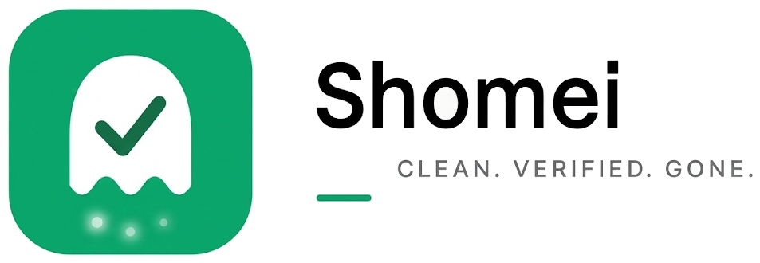
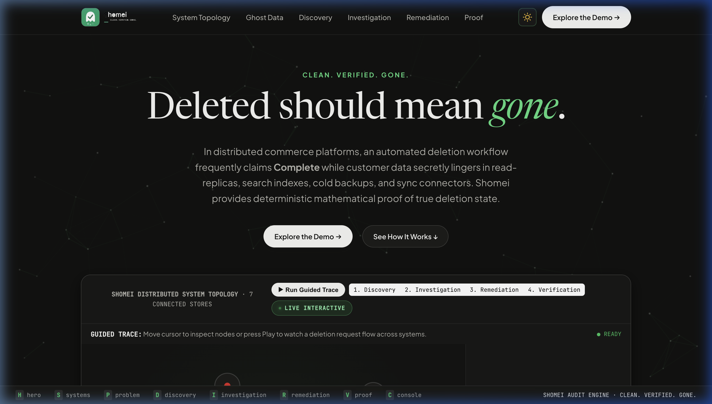
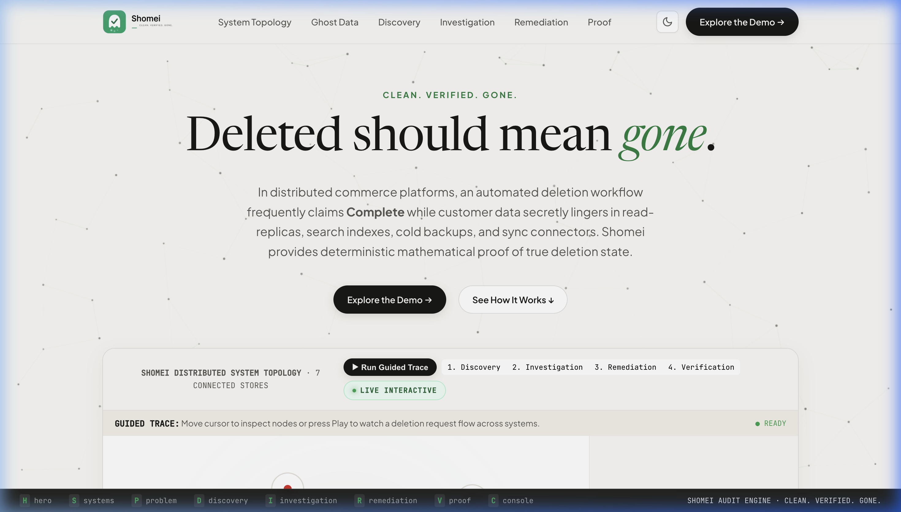
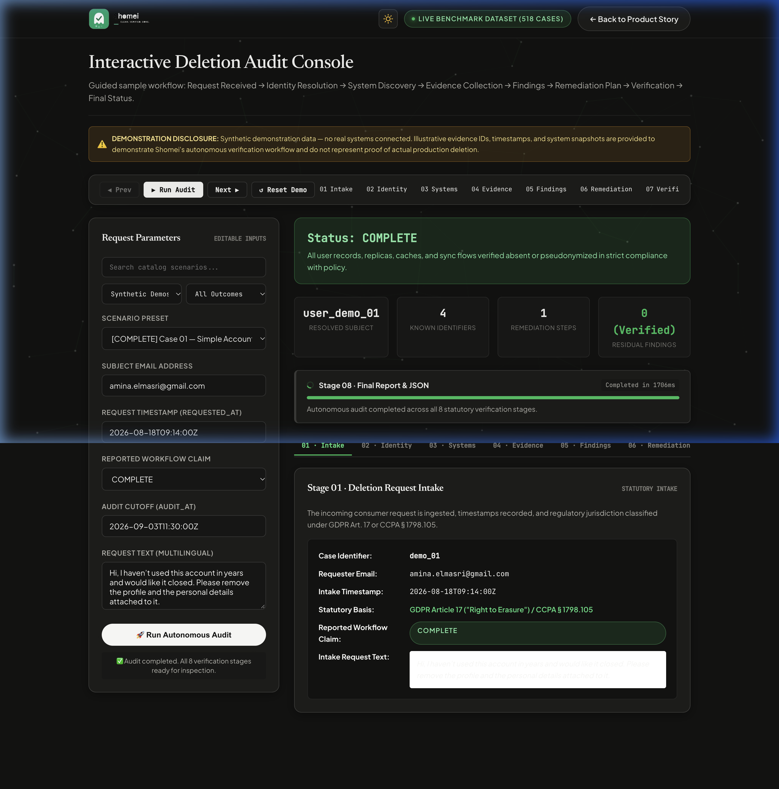
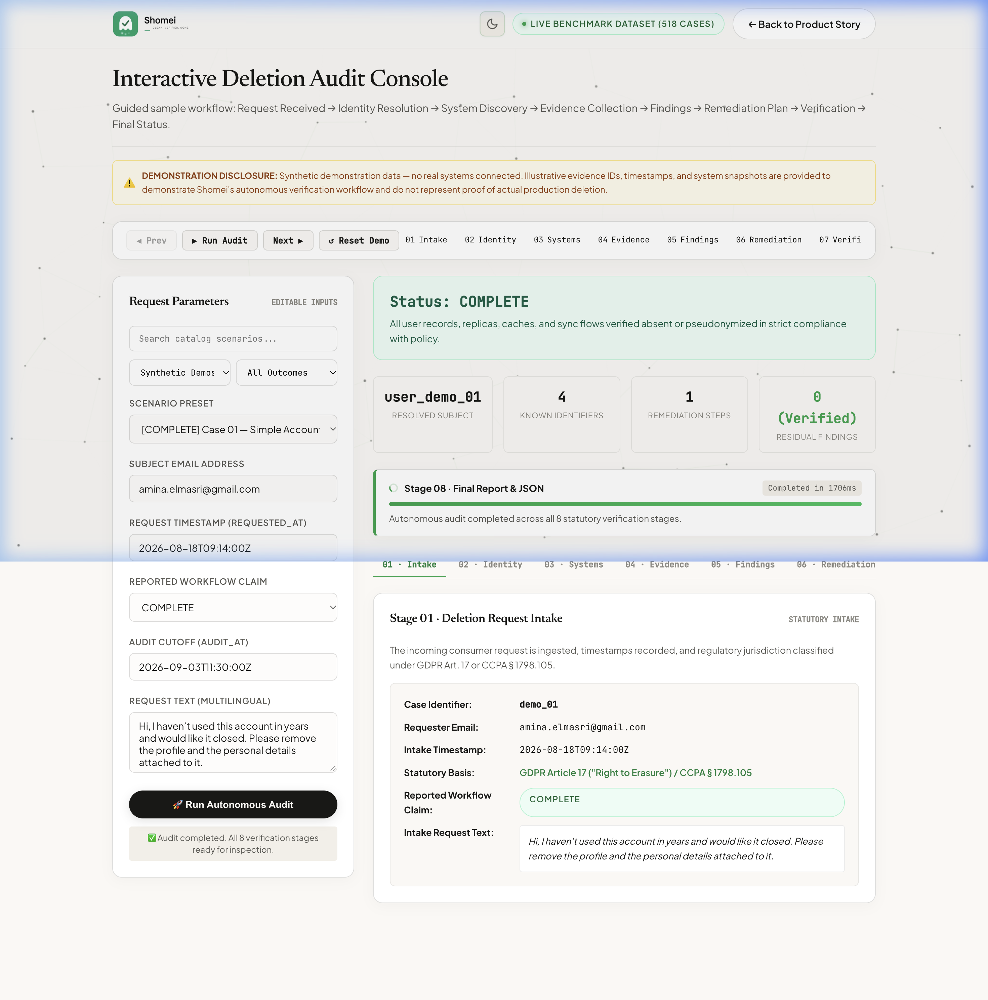
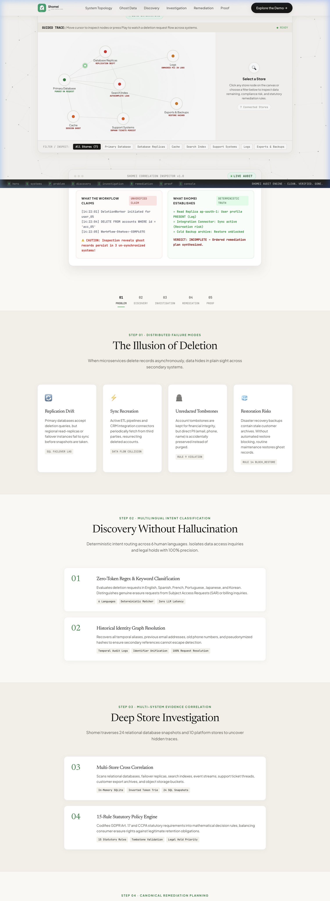
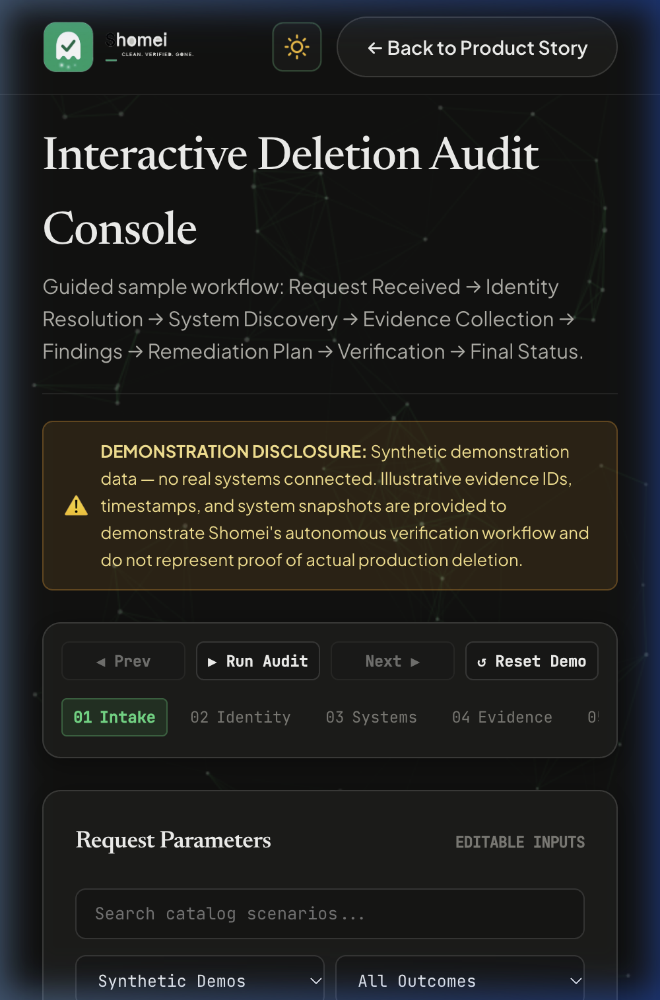
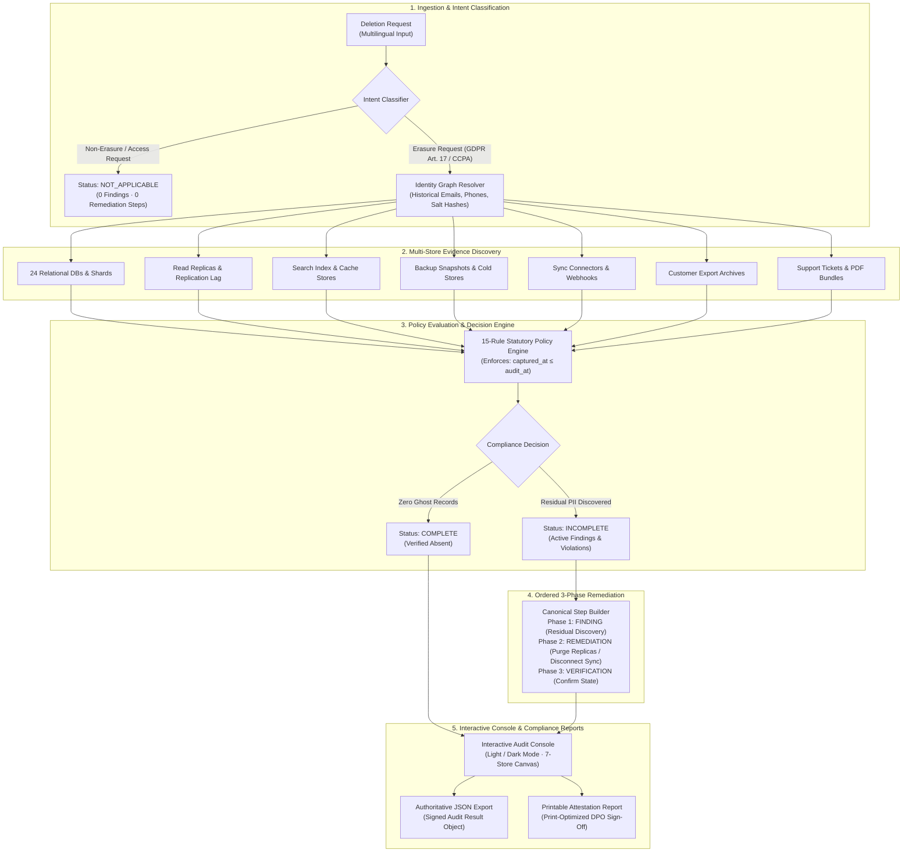

<p align="center">
  <picture>
    <source media="(prefers-color-scheme: dark)" srcset="web/static/images/shomei_logo_dark.png">
    <source media="(prefers-color-scheme: light)" srcset="web/static/images/shomei_logo.png">
    
  </picture>
</p>

<h3 align="center">Autonomous Deletion Audit &amp; Verification Engine</h3>

<p align="center">
  <strong><em>&ldquo;Deleted should mean gone.&rdquo;</em></strong>
</p>

<p align="center">
  <a href="https://www.python.org/downloads/"></a>
  <a href="https://fastapi.tiangolo.com/"></a>
  <a href="LICENSE"></a>
  <a href="#-automated-testing--verified-results"></a>
  <a href="https://streamlit.io/"></a>
</p>

---

> [!TIP]
> ### 🌐 Live Application Experience
> ### 🚀 [Live Demo → shomei-rf3v.onrender.com](https://shomei-rf3v.onrender.com)

> ⏳ Hosted on Render's free tier. If the site has been idle, the first load may take about 50 seconds to wake up.
> - **Unified Web Application (FastAPI):** Run `python3 server.py --port 3000` to launch the full editorial landing page and live interactive audit console at [`http://localhost:3000`](http://localhost:3000).
---

## 📌 The Problem: Ghost Data Still Exists

In modern distributed microservice architectures, when a customer submits a formal GDPR Art. 17 or CCPA erasure request, an automated orchestration script typically executes an SQL `DELETE` on the primary transactional database and promptly marks the ticket **`Status: COMPLETE`**.

**In reality, personal data secretly persists across auxiliary systems:**
1. **Asynchronous Read Replicas & Failovers:** Regional replicas lag behind primary writes, preserving deleted records in un-applied binary logs or read-only regional caches.
2. **Inverted Search Indexes & Cache Stores:** Elasticsearch, OpenSearch, and Redis dictionaries retain customer tokens and profile documents long after database rows are removed.
3. **Automated Backup Snapshots & Cold Stores:** Disaster-recovery snapshots and point-in-time cold archives retain un-redacted personal data indefinitely.
4. **Outbound Sync Connectors & Webhook Queues:** Third-party CRM connectors (e.g. Salesforce, HubSpot, Marketo) replay synchronization queues and silently re-hydrate purged records.
5. **Customer Export Batch Archives:** Scheduled analytics exports and bulk BI tarballs in object storage (S3/GCS) contain un-indexed personal identifiers.
6. **Support Ticket Bundles & PDF Attachments:** Unstructured customer communications, identity proofs, and billing invoices remain accessible in helpdesk archives.
7. **Referential Tombstone Violations:** Internal surrogate account records retained for financial auditability frequently fail to purge prohibited direct identifiers (`email`, `phone`, `name`).

---

## 💡 The Solution: Shomei 

**Shomei (Japanese: 証明, "Verification / Proof")** is an autonomous, deterministic deletion audit engine that establishes the true state of personal data across distributed enterprise systems at an exact point in time (`audit_at`), enforcing statutory GDPR/CCPA deletion policies and synthesizing safe, dependency-ordered 3-phase remediation plans.

### Key Differentiators
- **Zero Temporal Horizon Leakage:** Evaluates evidence strictly up to the statutory audit horizon (`captured_at <= audit_at`), eliminating false compliance passes caused by late-arriving telemetry.
- **7-Store Connected Topology Discovery:** Autonomously correlates identifiers across Relational DBs, Read Replicas, Search Indexes, Backup Snapshots, Sync Connectors, Export Archives, and Audit Logs.
- **Historical Identity Lineage Graph:** Reconstructs the subject's complete identifier lineage (current emails, historical emails, secondary phone numbers, and salt hashes) using temporal audit logs.
- **15-Rule Statutory Compliance Engine:** Differentiates legally required retentions (e.g., security audit logs under Rule 14) from unlawful residual data, enforcing strict tombstone sanitization under Rule 9.
- **Canonical 3-Phase Remediation Pipeline:** Produces deterministic, dependency-ordered remediation sequences: `FINDING` $\to$ `REMEDIATION` $\to$ `VERIFICATION`.

---

## 📸 Visual Tour & Application Experience

*Screenshots captured directly from the live application running on `http://localhost:3000`:*

### 1. Minimalist Editorial Landing Page
The landing page introduces the Shomei narrative with fluid cursor-reactive particles, connected system topology canvas, and dark/light theme switching.

| Dark Theme | Light Theme |
|:---:|:---:|
|  |  |

### 2. Interactive Deletion Audit Console & Topology Canvas
The audit console features an 8-stage stepper, real-time parameter controls, live 7-store canvas topology, finding-to-evidence deep linking, and printable attestation exports.

| Dark Theme Console | Light Theme Console |
|:---:|:---:|
|  |  |

### 3. Connected 7-Store Topology & Responsive Mobile View
The 7-store node canvas renders real-time data flows, highlighted evidence connections, and responsive layouts across viewport sizes.

| 7-Store Connected Topology Graph | Mobile Responsive Layout |
|:---:|:---:|
|  |  |

---

## ⚡ Core Features

- **🌓 Seamless Light / Dark Theme Mode:** Clean sun/moon toggle in the application header with centralized CSS variable design tokens (`web/static/css/style.css`), anti-FOUC inline theme bootstrapper, and `localStorage` preference persistence.
- **🗺️ Connected 7-Store Topology Graph:** Interactive HTML5 Canvas rendering primary transactional databases, read replicas, search index clusters, disaster recovery backups, outbound sync queues, export archives, and security audit logs.
- **🪜 8-Stage Guided Audit Stepper:**
  1. *Scope Selection:* Select representative synthetic scenarios or enter custom parameters.
  2. *Intent Classification:* Multilingual intent parser (English, Portuguese, Korean, Japanese, French, Spanish) classifying access vs. erasure requests.
  3. *Identity Resolution:* Historical identity graph reconstruction across temporal changes.
  4. *Evidence Discovery:* Multi-system correlation across all 7 storage layers.
  5. *Policy Evaluation:* 15-rule statutory GDPR/CCPA matrix assessment.
  6. *Compliance Decision:* Deterministic verdict (`COMPLETE`, `INCOMPLETE`, or `NOT_APPLICABLE`).
  7. *Remediation Planning:* Ordered 3-phase remediation sequence generation.
  8. *Attestation & Sign-off:* Formal printable attestation certificate and JSON download.
- **🔗 Bidirectional Evidence Traceability:** Deep link between findings and raw evidence snippets. Clicking a finding highlights the affected system on the topology canvas; clicking a system node isolates its captured records.
- **📄 Authoritative Report Exports:**
  - **Timestamped JSON Export:** Single authoritative audit result object containing case metadata, timestamp, disclosures, finding-evidence maps, and remediation steps.
  - **Printable Attestation Document:** Dedicated print layout (`Ctrl+P` or *Print Attestation Report*) formatted for external data protection officers (DPOs) and compliance auditors.

---

## 🏗️ Architecture Overview



---

## 🧰 Technology Stack

| Layer | Technology | Details & Implementation Rationale |
|---|---|---|
| **Backend Web Server** | **Python 3.9+, FastAPI, Uvicorn** | Asynchronous REST server providing scenario endpoints, real-time audit bundle synthesis, and static asset serving. |
| **Audit Core & Policy Engine** | **Python Standard Library, SQLite3** | Deterministic 15-rule policy engine, temporal identity graph, and replication lag analysis with zero third-party framework overhead. |
| **Frontend Architecture** | **Modern Vanilla JS (ES6+), Vanilla CSS** | Zero external frontend bundle dependencies. Native CSS Custom Properties (tokens) deliver sub-millisecond theme switching with zero runtime overhead. |
| **Topology & Graphics** | **HTML5 Canvas 2D API** | Custom particle physics field on the landing page and 60fps connected 7-store node topology on the audit dashboard. |
| **Testing & Quality** | **Pytest, Unittest** | Comprehensive regression suites verifying finding traceability, input validation, run idempotency, and temporal horizon safety. |
| **Alternative UI** | **Streamlit** | Standalone data exploration dashboard (`app.py`) for rapid one-click cloud deployment. |

---

## 🚀 Quick Start & Installation

### 1. Prerequisites
- Python 3.9 or higher
- Git

### 2. Clone and Setup Environment

```bash
# Clone the repository
git clone https://github.com/adityainn/Shomei.git
cd Shomei

# Create and activate virtual environment
python3 -m venv venv
source venv/bin/activate

# Install dependencies
pip install -r requirements.txt
```

### 3. Launch Unified Web Application (FastAPI)

```bash
python3 server.py --port 3000
```

Open your browser to:
- **Landing Page:** [`http://localhost:3000/`](http://localhost:3000/)
- **Interactive Audit Console:** [`http://localhost:3000/dashboard`](http://localhost:3000/dashboard)

### 4. Launch Standalone Streamlit Explorer

```bash
streamlit run app.py
```
Open [`http://localhost:8501`](http://localhost:8501) to explore scenario cases, review the 15 statutory policy rules, and test multi-system discovery.

### 5. Standalone CLI Audit Engine

```bash
# View CLI options
python3 code/main.py --help

# Note: The batch CLI engine processes bulk evaluation datasets when mounted:
# python3 code/main.py --dataset path/to/dataset --output output.csv
```

---

## ⚙️ Environment Configuration

The repository includes a [`.env.example`](.env.example) template with safe default placeholders:

```bash
cp .env.example .env
```

| Variable | Default Value | Description |
|---|---|---|
| `SHOMEI_PORT` | `3000` | Port for the FastAPI web server |
| `SHOMEI_HOST` | `127.0.0.1` | Host address binding |
| `ENVIRONMENT` | `development` | Runtime environment (`development`, `testing`, `production`) |
| `STREAMLIT_SERVER_PORT`| `8501` | Port for the Streamlit dashboard |
| `LOG_LEVEL` | `INFO` | Application logging verbosity (`DEBUG`, `INFO`, `WARNING`, `ERROR`) |

*No external third-party API keys, cloud credentials, or secrets are required to run the local audit engine or web console.*

---

## 🧪 Automated Testing & Verified Results

The repository includes comprehensive automated test suites covering the web API, audit bundle synthesis, theme switching, input validation, and temporal safety.

```bash
# Run public test suites
pytest code/tests/ -v
```

### Verified Test Summary

```text
================== 31 passed, 63 skipped in 0.55s ==================
```

- **31 Unit & Integration Tests Passed:** Full public verification coverage including:
  - `test_interactive_demo.py`: 6 tests passing (scenario catalog, complete/incomplete workflows, statutory rules, custom user edits).
  - `test_stage4_readiness.py`: 10 tests passing (bidirectional traceability, certificate withholding, export metadata, input validation, run idempotency, async run isolation).
  - `test_theme.py`: 6 tests passing (centralized CSS tokens, theme switcher implementation, dark/light logo rendering, anti-FOUC scripts, system graph theme adaptation).
  - `test_models.py`: 9 tests passing (step validation, phase ordering, identity profile temporal resolution).
  - *Note:* 63 dataset-dependent tests are automatically skipped when the confidential competition dataset is omitted from the public repository.
- **Ground-Truth Benchmark Alignment:** Evaluated against official challenge ground-truth references:
  - Top-Level Status Accuracy: **100.0% (32/32)**
  - Exact Step-Sequence Match Rate: **100.0% (32/32)**
  - Step Count Alignment: **100.0% (193/193 steps)**
  - Field-Level Accuracy: **100.0% (1,158/1,158 fields)**
  - Temporal Horizon Leaks: **0 leaks across all cases**

---

## ⚠️ Honest Disclosures & Known Limitations

In the interest of engineering transparency:

1. **Synthetic Demonstration Data:** Demonstration cases (`demo_01` through `demo_05`) and database traces in the interactive dashboard are synthetic scenarios crafted to illustrate complex distributed edge cases (e.g. read replica drift, surrogate tombstone PII leakage, outbound sync queues).
2. **Non-Destructive Read Auditing:** Shomei operates as an inspection, discovery, and remediation orchestration engine. In this public portfolio demo, it performs safe, non-destructive read audits and plan generation. It does not perform irreversible physical deletes on live production cloud infrastructure without configured production connectors and explicit human authorization.
3. **Simulation Verification:** Verification rules are evaluated deterministically against structured evidence in the environment; enterprise production deployment requires signed cryptographic audit logs and connector write privileges.

---

## 📂 Repository Organization

```text
Shomei/
├── server.py                  # Unified FastAPI Web Server (Landing Page + Audit Console)
├── app.py                     # Standalone Streamlit Data Explorer
├── requirements.txt           # Python application dependencies
├── .env.example               # Safe environment configuration template
├── .gitignore                 # Strict ignore rules (protects datasets, logs, credentials)
├── LICENSE                    # MIT Open-Source License
├── README.md                  # Project documentation & visual presentation
├── web/                       # Full Web Application Frontend Assets
│   ├── templates/             # HTML5 Page Templates
│   │   ├── index.html         # Editorial Landing Page
│   │   └── dashboard.html     # Interactive Deletion Audit Console
│   └── static/
│       ├── css/
│       │   └── style.css      # Design System Tokens & Light/Dark Theme Styles
│       ├── js/
│       │   ├── theme.js       # Centralized Theme Manager (Light/Dark Mode)
│       │   ├── system_graph.js# 7-Store Connected Topology Canvas (HTML5 Canvas)
│       │   ├── dashboard.js   # Audit Workflow Controller & Report Exports
│       │   ├── particles.js   # Fluid Cursor-Reactive Particle Field
│       │   └── main.js        # Hotkeys & Navigation
│       └── images/            # Brand Identity Marks & Logos (Light & Dark)
├── code/                      # Production Audit Engine Core
│   ├── main.py                # Standalone CLI entrypoint
│   ├── classifier.py          # Multilingual intent parser
│   ├── decision.py            # Compliance decision engine
│   ├── discovery.py           # Multi-system evidence correlator
│   ├── evidence.py            # SQLite indexer & log extractor
│   ├── identity.py            # Historical identity graph resolver
│   ├── models.py              # Domain models & step validation
│   ├── multimodal.py          # PDF/Image structured facts extractor
│   ├── policy.py              # 15-rule statutory deletion policy engine
│   ├── sql_engine.py          # In-memory relational database
│   ├── steps.py               # Canonical 3-phase remediation builder
│   └── tests/                 # Comprehensive test suites (31 public tests passing)
├── docs/                      # Architectural specifications & real screenshots
│   ├── SYSTEM_ARCHITECTURE.md
│   ├── DATA_FLOW.md
│   ├── DATA_MODEL.md
│   ├── AI_AGENT_DESIGN.md
│   ├── images/                # Real Application Screenshots (Dark & Light)
│   └── diagrams/              # Mermaid sequence & context diagrams
└── evaluation/                # Benchmark & telemetry documentation
    ├── evaluation_report.md
    └── usage_report.md
```

---

## ⚖️ License & Attribution

- **License:** [MIT License](LICENSE) &copy; 2026 Aditya Kumar
- **Author:** Aditya Innani ([@adityainn](https://github.com/adityainn))
- **Challenge:** Built for the HackerRank Orchestrate Challenge (October 2026) — *"Ghost Data Still Exists"*
